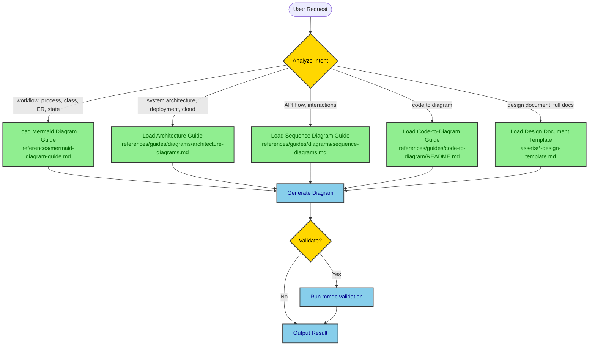
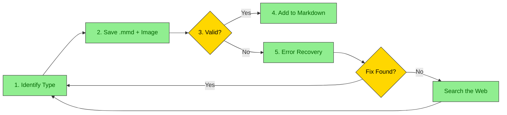
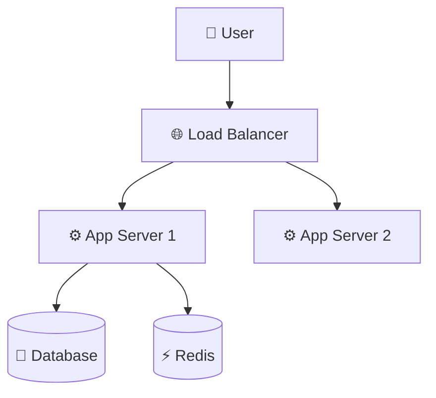
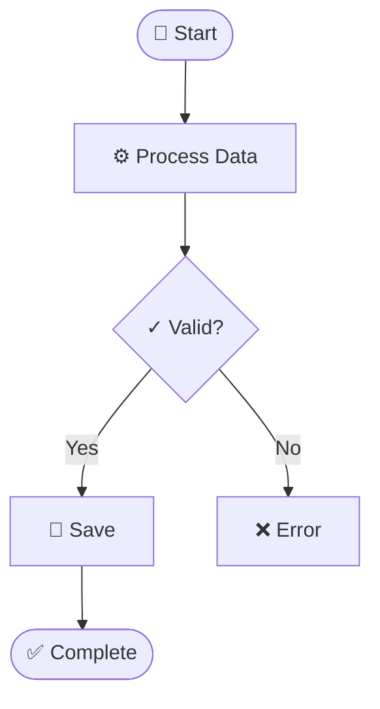
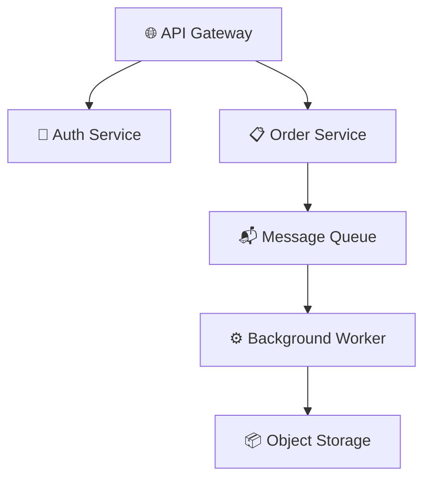

# Mermaid Architect - Hierarchical Diagram and Documentation Skill

Mermaid diagram and documentation system with specialized guides and code-to-diagram capabilities.

## Table of Contents

- [Decision Tree](#decision-tree)
- [Available Guides and Resources](#available-guides-and-resources)
- [GitHub wiki, WikiTicket, and Confluence](#github-wiki-wikiticket-and-confluence)
- [Usage Patterns](#usage-patterns)
- [Resilient Workflow](#resilient-workflow)
- [Unicode Semantic Symbols](#unicode-semantic-symbols)
- [Decision Tree Examples](#decision-tree-examples)
- [High-Contrast Styling](#high-contrast-styling)
- [File Organization](#file-organization)
- [When to Use What](#when-to-use-what)
- [Best Practices](#best-practices)

## Decision Tree

This static install bundles no scripts. Generate Mermaid fences in markdown. If PNG/SVG export is required, use a locally available renderer the user already has (for example `mmdc`) or ask before installing anything.

**How this skill works:**

1. **User makes a request** → Skill analyzes intent
2. **Skill determines diagram/document type** → Loads appropriate guide(s)
3. **AI reads specialized guide** → Generates diagram/document using templates
4. **Result delivered** → With validation and export options

**User Intent Analysis:**



## Available Guides and Resources

### Diagram Guides

| Guide | Full Path | Load When User Wants | Examples |
|-------|-----------|---------------------|----------|
| Mermaid Diagram Guide | `references/mermaid-diagram-guide.md` | Flowcharts (workflows, processes, decision trees), class, ER, state, Gantt, user journeys, styling, common syntax errors | "Show checkout flow", "ER diagram for orders", "State machine for payments" |
| Architecture Diagrams | `references/guides/diagrams/architecture-diagrams.md` | System architecture, C4 context/container/component, deployment and hosting, microservices, event-driven | "Show system components", "Document GCP deployment", "Architecture overview" |
| Sequence Diagrams | `references/guides/diagrams/sequence-diagrams.md` | API interactions, service communication, request/response flows | "Show API call sequence", "Document auth flow", "Service interactions" |

### Code-to-Diagram Guide

**Full Path:** `references/guides/code-to-diagram/README.md`

Complete workflow for analyzing a codebase and extracting diagrams, with sections for Spring Boot, FastAPI, React, Express, Java Servlet, and Python ETL.

### Design Document Templates

| Template | Full Path | Use For | Load When |
|----------|-----------|---------|-----------|
| Architecture Design | `assets/architecture-design-template.md` | System-wide architecture | "Create architecture doc", "Document system design" |
| API Design | `assets/api-design-template.md` | API specifications | "API design doc", "Document REST API" |
| Feature Design | `assets/feature-design-template.md` | Feature planning | "Feature design", "Plan new feature" |
| Database Design | `assets/database-design-template.md` | Database schema | "Database design", "Document schema" |
| System Design | `assets/system-design-template.md` | Complete system | "System design doc", "Full system documentation" |

## GitHub wiki, WikiTicket, and Confluence

Default for WikiTicket design docs, code walkthroughs, requirements, and GitHub wiki is this skill, including `classDiagram`, `erDiagram`, and `stateDiagram-v2`. Do not send those to PlantUML. If GitHub fails to render C4 / architecture-beta / block-beta, fall back to `flowchart TD`.

| Target | What to ship |
|--------|----------------|
| GitHub wiki / GFM | Fenced `mermaid` block. GitHub renders class, ER, state, sequence, flowchart, C4. |
| Confluence / Notion / Word / PDF | Also render PNG or SVG (`mmdc` or another local renderer if available) and upload the image. Do not rely on Confluence to render Mermaid. |

PlantUML is opt-in for Salt wireframes, use case, timing, ArchiMate, nwdiag, and WBS. Those always ship as PNG or SVG.

## Usage Patterns

Common request patterns and guide selection. See [When to Use What](#when-to-use-what) for complete mapping.

| Pattern | Example Request | Guides to Load |
|---------|-----------------|----------------|
| Single Diagram | "Create activity diagram for login flow" | Diagram guide + Unicode symbols below |
| Code-to-Diagram | "Generate deployment from application.yml" | Code-to-diagram guide + Architecture guide |
| Design Document | "Create API design document" | Template from assets/ + relevant diagram guides |
| Extract/Validate | "Extract diagrams from design.md" | Extract the fences manually; validate with `mmdc` if available |

## Resilient Workflow

**CRITICAL:** This is the recommended approach for ALL diagram generation. It ensures validation, error recovery, and consistent file organization.

**Full Guide:** `references/guides/resilient-workflow.md`

### Workflow Overview



### Key Principle

**NEVER add a diagram to markdown until it passes validation.** This prevents broken diagrams in documentation.

### File Naming Convention

```
./diagrams/<markdown_file>_<num>_<type>_<title>.mmd
./diagrams/<markdown_file>_<num>_<type>_<title>.png
```

**Example:** `./diagrams/api_design_01_sequence_auth_flow.png`

### Steps

1. **Identify diagram type** from first line (flowchart, sequence, etc.)
2. **Load the matching guide** from [Available Guides and Resources](#available-guides-and-resources)
3. **Save to** `./diagrams/<markdown_file>_<num>_<type>_<title>.mmd`
4. **Validate:** `mmdc -i file.mmd -o file.png -b transparent`
5. **On error:** Check the error patterns in `references/guides/resilient-workflow.md` and the Common Errors and Fixes section of `references/mermaid-diagram-guide.md`
6. **If not found:** Search the web with the host's search tool
7. **Add reference:** ``

## Unicode Semantic Symbols

Always use Unicode symbols to enhance diagram clarity.

**Quick Reference:**
- 📦 Infrastructure: ☁️ 🌐 🔌 📡 🗄️
- ⚙️ Compute: ⚙️ ⚡ 🔄 ♻️ 🚀 💨
- 💾 Data: 💾 📦 📊 📈 🗃️ 🧊
- 📨 Messaging: 📨 📬 📤 📥 🐰 📢
- 🔐 Security: 🔐 🔑 🛡️ 🚪 👤 🎫
- 📝 Monitoring: 📝 📊 🚨 ⚠️ ✅ ❌

### Infrastructure & Deployment


### Activity Flow with States


### Microservices Architecture


## Decision Tree Examples

### Example 1: User Asks for Workflow Diagram

**Input:** "Show the checkout process workflow"

**Skill Decision Path:**
```
1. Analyze: workflow, process → FLOWCHART
2. Load guide: references/mermaid-diagram-guide.md (Flowcharts)
3. Generate with decision points + Unicode symbols
4. Output flowchart with cart, payment, and order states
```

### Example 2: User Provides Spring Boot Code

**Input:** "Here's my Spring Boot controller, create diagrams"

**Skill Decision Path:**
```
1. Analyze: Spring Boot, code provided → CODE-TO-DIAGRAM
2. Load guides:
   - references/guides/code-to-diagram/README.md (Spring Boot section)
   - references/guides/diagrams/architecture-diagrams.md (for structure)
   - references/guides/diagrams/sequence-diagrams.md (for method calls)
   - references/mermaid-diagram-guide.md (flowcharts for business logic)
3. Generate multiple diagrams:
   a. Architecture diagram from @RestController/@Service/@Repository annotations
   b. Sequence diagram from method call chain
   c. Flowchart from business logic
4. Output all diagrams with explanations
```

### Example 3: User Wants Infrastructure Documentation

**Input:** "Document my GCP Cloud Run deployment with AlloyDB"

**Skill Decision Path:**
```
1. Analyze: infrastructure, GCP, Cloud Run → DEPLOYMENT (C4 container)
2. Load guide: references/guides/diagrams/architecture-diagrams.md
3. Check for IaC files (Pulumi, Terraform, docker-compose)
4. Generate deployment diagram with:
   - Cloud Run services with specs
   - VPC connector
   - AlloyDB cluster
   - Security (IAM, Secret Manager)
   - Monitoring
5. Apply Unicode symbols for clarity
6. Output with resource specifications
```

## High-Contrast Styling

**ALL diagrams MUST use high-contrast colors:**

```mermaid
graph TB
    classDef primary fill:#90EE90,stroke:#333,stroke-width:2px,color:darkgreen
    classDef secondary fill:#87CEEB,stroke:#333,stroke-width:2px,color:darkblue
    classDef database fill:#E6E6FA,stroke:#333,stroke-width:2px,color:darkblue
    classDef error fill:#FFB6C1,stroke:#DC143C,stroke-width:2px,color:black

    %% Every classDef MUST have color: property
```

**Rules:**
- Light background → Dark text color
- Dark background → Light text color
- Always specify `color:` in every `classDef`

## File Organization

```
design-doc-mermaid/
├── SKILL.md
├── references/
│   ├── mermaid-diagram-guide.md          # Flowchart, class, ER, state, Gantt, styling, errors
│   └── guides/
│       ├── resilient-workflow.md         # Validate-before-adding workflow
│       ├── diagrams/
│       │   ├── architecture-diagrams.md  # C4, deployment, microservices
│       │   └── sequence-diagrams.md      # API interactions
│       └── code-to-diagram/
│           └── README.md                 # Code analysis, per-framework sections
└── assets/                               # Design document templates
    ├── architecture-design-template.md
    ├── api-design-template.md
    ├── feature-design-template.md
    ├── database-design-template.md
    └── system-design-template.md
```

## When to Use What

| User Request | Load This |
|--------------|-----------|
| "activity diagram", "workflow", "process flow", "flowchart" | `references/mermaid-diagram-guide.md` |
| "class diagram", "ER", "state machine", "Gantt" | `references/mermaid-diagram-guide.md` |
| "deployment", "infrastructure", "cloud", "k8s" | `references/guides/diagrams/architecture-diagrams.md` |
| "architecture", "system design", "components" | `references/guides/diagrams/architecture-diagrams.md` + design template |
| "API", "sequence", "interactions", "flow" | `references/guides/diagrams/sequence-diagrams.md` |
| "Spring Boot", "FastAPI", "React", "Express", "ETL" code | `references/guides/code-to-diagram/README.md` + relevant diagram guides |
| "syntax error", "diagram won't render", "troubleshoot" | Common Errors and Fixes in `references/mermaid-diagram-guide.md` + `references/guides/resilient-workflow.md` |
| "Confluence", "upload image", "PNG", "SVG" | A local Mermaid renderer if available |
| "create diagram", "add diagram to markdown" | `references/guides/resilient-workflow.md` |
| "design document", "full docs" | `assets/*-design-template.md` + diagram guides |

## Best Practices

1. **Single Responsibility**: One diagram = One concept
2. **Unicode Enhancement**: Always use semantic symbols for clarity
3. **High Contrast**: Never skip the `color:` property in styles
4. **Validate Early**: Render with `mmdc` before adding a diagram to markdown
5. **Template Reuse**: Leverage existing templates and examples
6. **Load On-Demand**: Only read guides needed for the specific request
